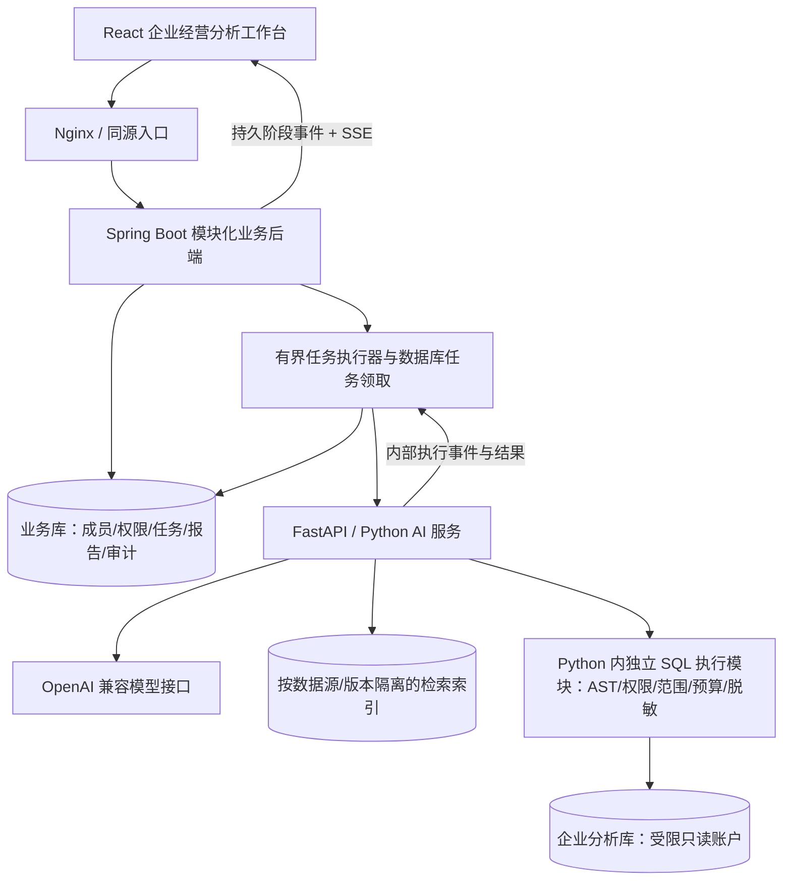

# ChatBI 企业经营智能分析 SaaS 改造规划

> 更新日期：2026-10-06。基于 `2650b49` 的源码扫描，已完成第一步的首组“执行入口与安全边界”代码改造，详见 [第一阶段文档](stages/phase-1-query-execution.md)。后续预算、只读账户、业务口径、Java 和持久任务仍未完成；下文扫描证据中的“未改动”指实施前的历史状态。
> 产品主线：让企业员工安全、准确地通过自然语言分析关系型数据库，并完成复杂经营问题的多步归因分析。
> 首个业务场景沿用现有新能源制造业数据，分析收入、成本、费用与经营利润；SaaS 能力围绕企业接入、数据治理和分析过程建设。
> 实施方式：沿一条路线逐步完善，每次完成一组具体改动并验证，再继续下一步。指标、Schema 和授权的修订记录仅用于业务追溯，不作为项目交付标签。

## 一、结论与改造边界

当前项目已经具备 Query Rewrite、Schema Linking、Text2SQL、指标检索、SQL 修复、Plan-and-Execute 和流式报告的基础。建议将现有能力收敛为一条受控智能分析链路，再补 SaaS 所需的身份、治理与持久业务状态。

推荐采用 **Spring Boot 模块化业务后端 + FastAPI/Python 分析服务 + React 工作台**。统一 SQL 安全执行层放在 Python 服务内，作为独立模块与 Agent 解耦；Java 负责授权决策及业务状态，Python 执行层负责强制实施。先形成完整闭环，不重写已有 AI 核心，不额外拆第三个执行服务。

| 用户关心的问题 | 推荐结论 |
|---|---|
| 保留哪些能力 | Query Rewrite、表/字段/关联检索、Text2SQL、指标知识、SQL 修复、多步计划执行、归因报告和 SSE 工作台 |
| 最缺哪些后端能力 | 租户与资源授权、可靠 SQL 执行治理、数据源/指标版本、持久任务/报告、审计和结果追溯 |
| 最终目标架构 | Java 管业务控制与持久状态；Python 管 AI 和统一受控查询；Java 是唯一对外业务入口 |
| Java / Python 边界 | Java 决定谁可访问什么和任务状态；Python 在该范围内检索、推理、执行及解释 |
| 应重构哪些模块 | 安全/数据库执行、全局 Schema/指标、共享运行时、重试/取消、历史隔离、前端流与任务状态 |
| 应新增哪些模块 | Java SaaS 业务模块、可信执行契约、Python 统一执行器与确定性归因、任务/步骤/报告/审计模型 |
| 简历亮点 | SQL 权限与预算治理、跨语言受控执行、可恢复任务、指标版本、可复算归因及真实评测 |
| 实施顺序 | 统一 SQL 安全执行 → Java 企业业务闭环 → 持久多步任务与报告 → 指标治理与可信归因 → 故障和质量验收 |
| 每次改动的要求 | 复用现有代码、保持主链路可用、完成必要验证、记录真实实现进度，再进入下一步 |

业务定位比新增框架更重要。仅增加 Spring Boot 转发接口和几个 CRUD 页面，不能显著提升项目价值。明确排除 GraphRAG、大量 Multi-Agent、Kafka、Kubernetes、微服务拆分，以及采购、库存、会员和订单处理系统。保留轻量关联图做 JOIN 路径推理，与 GraphRAG 无关。

## 二、扫描范围与验证边界

本次重新遍历、读取全部 104 个受 Git 管理文件，解析 57 个 Python 文件的结构，并复核关键调用链、前端状态、业务数据、测试和部署配置。逐文件与 HEAD 比较，业务代码没有变化，上一轮源码分析仍可复用；修正了上一版文档中汇率/费用表的误写名称。不以 README 的功能描述替代代码判断。

- Python：57 个文件，包含包初始化文件及测试；16 个测试模块。
- 前端：`frontend/src` 下 22 个文件，React、TypeScript、Ant Design 工作台。
- 实际技术基础：FastAPI、PyMySQL/MySQL、SQLite 用户与会话存储、Chroma 检索、OpenAI 兼容接口。
- 读取的是源码与配置模板；不读取本地 `.env` 的秘密值、用户/会话数据库内容，也不把第三方依赖和生成索引当作项目自有代码。

验证证据与日期：

| 验证 | 结果 | 能证明什么 |
|---|---|---|
| 当前源码一致性 | 2026-10-06：104 个受管文件与 HEAD 一致，Python AST 解析通过 | 当前项目尚未实施上一版规划，未发现新的业务代码变更 |
| 现有 Python 测试 | 2026-10-05：147 项通过，1 项第三方弃用警告；15.82 秒 | 测试覆盖的行为可复用；本次文档更新没有重复运行测试 |
| 前端 TypeScript 检查 | 2026-10-05：通过 | 类型关系成立；不等于生产构建或浏览器端到端验证 |
| 安全管理器只读探查与源码复核 | 2026-10-05 探查；2026-10-06 复核实现未变 | 直接订单、OR、结果别名限制缺口仍存在；未对真实数据库执行探查 SQL |
| 历史模型评测 | 2026-10-02：42/50，即 84% | 特定数据集与路径的历史结果；本次未调用真实模型重新评测 |

上一轮测试使用隔离的临时用户/会话存储，关闭会访问真实检索/模型的可选功能；`query_rewrite` 保留为测试预期的开启状态，模型调用由测试替身处理。该开关全部关闭时两项改写测试失败，匹配预期后全量通过；后续测试需显式声明开关，避免依赖机器环境。

本次未启动整套容器，也未验证真实模型、真实数据库的并发、隔离、取消效果。本文的架构和分期是改造建议，不是已实现功能清单。

## 三、当前项目实际有什么

### 3.1 已经存在的企业业务雏形

初始化数据已经围绕制造业销售经营展开，包含五张真实业务表：`dim_customers`、`dim_products`、`sales_orders`、`exchange_rates`、`finance_expenses`。产品具有电池、储能等业务语义，客户包含地区和类型，订单包含金额、数量、状态及币种，费用包含期间与部门。目前只有 5 个客户、5 个产品、5 笔订单、7 条汇率、3 条费用记录，主要用于演示。

`indicators_full.json` 定义了 13 个指标，涉及收入、销售成本、毛利、毛利率、期间费用、利润、客单价、订单量、研发/销售费用率、产品线收入、区域收入、销量。

因此适合沿用“新能源制造企业”的业务背景，不需要另造一个电商或金融业务场景，更不需要把订单录入、库存、采购、财务记账全部做进来。

### 3.2 当前主要链路

```text
单查询：登录 → 提交问题 → 指标检索 / 历史改写 → Schema Linking / Prompt
       → LLM 生成 SQL → 安全处理 → MySQL 执行 → 格式化结果 → 保存历史

多步分析：提交问题 → 问题拆解 → 依赖计划 → 顺序执行各步骤
         → SQL 失败修复 / 依赖失败跳过 → LLM 或模板生成报告 → 保存历史

展示：FastAPI SSE → 前端阶段、SQL、结果、步骤及 Markdown 报告
```

这里的 Agent 已有结构化计划和执行能力，但执行动作主要是 Text2SQL，尚不是可任意调用业务工具、持久运行或跨故障恢复的通用 Agent 平台。

### 3.3 能力与复用判断

| 模块与代码入口 | 已有能力 | 判断与下一步 |
|---|---|---|
| `services/chatbi_service.py` | 单次与流式查询、历史改写、检索与运行时注入 | 保留主链路，显式传入可信执行上下文；拆出复用的查询执行结果对象 |
| `retrieval/schema_linker.py`、`table_retriever.py`、`field_matcher.py` | 表召回、业务字段匹配、动态 Schema、降级 | 很值得保留；补来源、版本和权限范围，降级也不能越过允许的 Schema |
| `retrieval/join_resolver.py` | 关联图、最短路径、指标意图锚点、复合关联键 | 保留；不必引入图数据库，先把硬编码关系变成版本化元数据 |
| `retrieval/indicator_knowledge.py`、`indicator_retriever.py` | 指标语义、关键词/向量检索、依赖补充 | 保留；统一指标事实源，补递归依赖、访问范围和发布版本 |
| `text2sql/query_rewriter.py` | 识别追问、历史指代补全、改写结果清洗、失败退回原问题 | 保留；只接收当前源及当前权限允许的历史，保留可见改写结果 |
| `text2sql/prompt_builder.py` | Few-shot、业务规则、错误规避与动态 Schema 注入 | 保留；规则是质量辅助，不能代替执行前校验 |
| `analysis/query_decomposer.py`、`agent_planner.py` | 结构化拆解、依赖校验、计划、分步 SQL 修复、中间结果 | 保留；增加预算、取消、状态回传、请求隔离和明确失败分类 |
| `analysis/report_generator.py` | 结构化报告、Markdown、模板降级 | 保留展示能力；增加证据引用、口径版本和数值校验 |
| `core/auth.py`、`api/routes.py` | 注册待授权、登录、JWT、角色和区域分配、逐请求核验当前用户 | 已有基础鉴权，不能称“完全没有权限”；业务身份最终迁到 Java |
| `core/security.py`、`execution/` | 身份、AST 表/列/函数与作用域校验、区域改写 | 首组已完成：执行前拒绝敏感来源，统一安全执行；仍限固定五表及明确 SQL 子集 |
| `infrastructure/database.py`、`bootstrap/runtime_factory.py` | 数据源配置入口、轻量连接池、超时设置、错误分类、慢查询信息 | 保留接口思路；目前实际驱动是 MySQL，补连接生命周期、执行预算和结果限制 |
| `infrastructure/session_store.py` | 用户+会话隔离、保留期、轮次上限、SQLite WAL | 保留需求和测试；正式会话由 Java 存储，补租户/数据源/权限版本隔离 |
| `frontend/src` | 登录授权、会话侧栏、单查询/分析双模式、SQL 和结果展示、报告下载 | 最大化复用组件；逐步增加任务和治理页面，不重写工作台 |
| `tests`、`tools/evaluator.py`、`reports/evaluation_report.md` | 行为测试、执行结果评测、难度统计 | 保留并改进，新增真正针对隔离、故障和业务正确性的验证 |

当前实现有几个边界应明确：Query Rewrite 已用于单查询，但归因入口主要在完成后保存历史，尚未完整复用历史改写；单查询默认不执行 SQL 修复，修复主要在多步执行器中。首组已将指标检索移到问题改写之后，单查询和 Agent 子步骤复用安全执行入口，子步骤不读写用户会话。历史的跨源/降权重校验、整体 Query Pipeline 和统一总预算仍待完善。

## 四、当前缺口：优先处理真实问题

### 4.1 数据安全与权限链路，优先级最高

以下探查描述改造前的缺口。2026-10-06 首组已补身份拒绝、AST 表/列/函数校验和基础表区域限制，直接订单、OR、别名及嵌套来源已纳入回归；租户/源授权、历史降权与只读数据库账户仍未完成。

当前销售区域限制只在 SQL 引用客户表时加入。直接查询订单事实表时没有自动关联客户范围；现有过滤也没有充分处理 OR、子查询和不同查询层级。

只读探查例子：

```sql
-- 当前区域策略对直接订单查询没有追加限制：
SELECT COUNT(*) AS orders FROM sales_orders;

-- 当前追加后的条件结构：AND 优先于 OR，不能保证整体条件受限：
WHERE 1=1 OR c.region='NorthAmerica' AND c.region='Europe'

-- 当前结果列名脱敏不能可靠识别这种别名及派生结果：
SELECT SUM(net_amount) AS revenue FROM sales_orders;
```

最后一个例子同时说明：字段访问控制应在 SQL 执行前判断原始列与表达式来源，不能仅对执行后名为 `net_amount` 的列隐藏数值。只读探查确认了按 `revenue` 别名返回时当前脱敏规则不生效，未执行以上查询。

另有这些真实缺口：

- 只读校验主要依赖字符串和关键字，没有允许表/列及函数范围；例如只读不等于不能访问系统信息或消耗大量资源。
- 部分内部路径缺少上下文时退回演示管理员。现有公开业务 API 已有鉴权，不能因此直接断言匿名接口可绕过；但未来内部服务必须缺上下文即拒绝。
- 没有租户身份与数据源归属；`source_id` 目前只是运行配置选择，不是资源授权模型。
- 历史只有用户与会话键，同一会话切数据源或用户权限缩小时，没有完整重新校验历史内容的机制。
- 浏览器本地状态、历史、报告、导出和检索都需要纳入同一权限边界，不能只检查生成 SQL 的接口。
- 数据库示例配置使用 root，不能承担“分析只读账户”的演示证据。

**处理原则：先拒绝无法证明安全的 SQL 和能力，再逐步扩展支持范围。提示词中的“遵守权限”不能充当权限系统。**

### 4.2 已有 SSE，但没有持久后台任务

当前分析与 HTTP 流绑定，步骤及中间结果主要在内存中。页面恢复依赖 `sessionStorage`，刷新后把运行中的卡片标为取消；浏览器取消读取，也不保证后台线程、模型或 SQL 已停止。

缺少任务实体、权威状态、执行批次、持久事件、幂等创建、取消协议、超时收敛与失败恢复。报告生成结束也不自动意味着分析完整成功；步骤失败、数量被截断时需要独立标记结果完整性。

### 4.3 数据源和知识尚未形成业务治理

- 多数据源配置已能传递连接参数，但表/字段元数据、关联图、静态 Schema、指标和向量集合仍主要是全局内容。连接可切换，不代表元数据与知识已经正确切换。
- 表检索包含用于干扰召回的其他领域元数据，不都对应实际初始化表，不能当作已接入业务。
- Chroma 索引是生成物，查询路径并不保证自动完成初始化；需要建立元数据发布、索引准备、版本切换的流程。
- `indicators.json` 和 `indicators_full.json` 两份来源有遗留引用，迁移前需梳理并收敛，而不是直接删掉一份。
- 数据源创建、验证、授权、停用、Schema 快照、指标审核发布、索引状态均没有完整管理闭环。

### 4.4 业务可信度不足以支撑“财务归因”

- 当前“利润”把净利润、营业利润、经营利润混为别名。建议明确为**简化经营利润：收入－销售成本－期间费用**，不宣称完整会计净利润。
- 当前成本取产品当前成本乘数量，并非订单发生时的成本快照；成本币种、计量单位和汇率口径也要补清楚。
- 汇率按订单日期/币种关联时要验证完整性；人民币订单的免换汇规则、外币缺汇率时的告警必须明确，不能因为 INNER JOIN 丢失订单后把结果当完整收入。
- 不同产品有 MWh、套等数量单位，不能直接相加后称企业总销量。
- 费用和订单是不同粒度事实表，不能直接明细关联求和；应分别聚合后按期间对齐。它们在同一 MySQL 中，可用子查询/CTE，也可分步骤执行，不是“必须跨数据库查询”的问题。
- 没有费用分摊数据时，可分析产品线收入、成本和毛利，不能编造产品线经营利润。
- 当前报告主要是模型解释，没有贡献值勾稽与逐项证据绑定。根因判断和业务假设必须分开。
- 未支持的维度应明确告知或追问，不能悄悄换成相似维度后当成已回答原问题。

### 4.5 工程运行与观测仍是演示级

当前存在共享 `AnalysisService` 重绑定模型相关对象、运行时连接池生命周期不明确、共享 `last_query_info`、无界步骤队列及结果 `fetchall` 等风险。它们在并发和多源场景需要改造；本次是静态发现，未进行并发复现。

首组已移除共享 `last_query_info`，SQL、结果和统计由每次执行独立返回，并通过双线程测试验证；其余共享运行时、连接池、有界队列与结果限制仍是后续任务。

重试也需收敛：SQL 语法或可修复执行错误可以有限修复；权限拒绝不应反复尝试“改写绕过去”；模型/数据库超时应服从统一总预算，避免多层重试叠加。

容器与运维方面：

- 健康接口即使数据库不可用也可能返回 HTTP 200，容器仅看 HTTP 状态不足以判断就绪。
- 构建复制 `chroma_db`，但该目录不受 Git 管理，干净检出不能假设它存在。
- 构建还复制 `data`，本地用户/会话库需要明确排除，避免进入镜像。
- 默认端口与 README 示例存在差异；实际可被环境变量覆盖，统一配置说明并用干净环境验收。
- 目前没有完整贯通的任务追踪、模型用量、拒绝事件、持久审计与仓库 CI。

### 4.6 现有评测可保留，但不能过度宣传

仓库的 84% 来自 `tools/evaluator.py` 的特定 Prompt 路径，不覆盖完整 Schema Linking、指标 RAG、Agent 和用户权限链路。50 个用例中有 13 个双方结果均为零行，且当前种子数据只有少量 2026 年第一季度记录，“上个月”会随执行时间变化而变成无数据。

不匹配也不全是模型错误：有指标是否换汇的口径冲突、结果别名差异和月份表示差异。当前比较逻辑对字符串/列名较严格，对需要排序的问题又需要补充顺序检查。

应把“业务值正确”“结果形状正确”“口径正确”“权限安全”分别验证，补非空数据、数值容差、约定的等价表示、固定业务日期，以及显式要求的排序。不能为抬高分数而任意忽略所有列名或结果差异。

## 五、推荐企业业务场景与最小闭环

### 5.1 场景定位

一家经营电池与储能产品的新能源制造企业，销售分欧洲、北美等区域。管理者和财务关注收入、毛利、期间费用和经营利润，销售人员关注自己区域的收入、订单和客户结构。

平台管理的是**分析业务**：企业成员、数据访问、指标口径、分析任务、报告与证据，不负责替代 ERP 完成订单或会计处理。

演示主问题固定为：“2026 年 3 月经营利润相比 2 月为什么下降？主要是收入、成本还是费用变化？”另准备一个欧洲销售用户，仅能分析自己区域的收入与订单；再准备第二家企业证明真正的租户隔离。

### 5.2 推荐角色与权限

| 角色 | 业务操作 | 数据范围 |
|---|---|---|
| 平台管理员 | 创建企业、平台运维 | 不默认获得各企业经营数据访问权 |
| 企业管理员 | 企业成员、授权、数据源管理、指标发布 | 数据阅读另按显式授权，不能把“管理用户”等同于“读取所有数据” |
| 财务分析员 | 财务指标、经营诊断、本人报告 | 所属企业已授权数据源，含成本和利润 |
| 区域销售 | 区域收入/订单分析、本人报告 | 所属企业与指定区域；可授权聚合收入，禁止成本/利润等敏感指标 |

这是建议策略，需要落实到演示用例。目前销售角色禁止金额字段的规则与“区域收入分析”有冲突，不能直接照搬。销售收入先通过已审核聚合指标模板提供，任意财务 SQL 暂不开放给销售；随后按实际用例扩大受控 Text2SQL 支持范围。

报告默认仅创建者可读。暂不做企业公共报告和复杂分享；后续共享需要独立授权，不因同属一个企业就自动可见。

### 5.3 产品闭环

```text
企业管理员配置演示数据源并授权
    → 财务用户选择已发布指标、数据源和分析期间
    → 发起查询或经营诊断，获得任务 ID
    → 查看执行阶段、步骤、受控 SQL 和结果
    → 查看经营变化贡献及证据报告
    → 刷新/断线后恢复查看，历史报告可再次打开
    → 管理员追踪授权变化和执行审计
```

前端优先复用原工作台，逐步补企业成员、数据源、指标目录、任务列表/详情和报告回看。审计先提供简单查询页面即可，不先建复杂管理门户。

### 5.4 项目完善到什么程度

按下列目标持续完善，不另设多套交付范围。具体改动按第十节的依赖顺序执行。

| 方面 | 完成条件 |
|---|---|
| 核心 AI | 现有改写、检索、生成、修复、多步执行与报告共用受控链路，失败和缺数据能够解释 |
| 企业业务 | 两家企业、成员角色、数据源授权和区域范围真实生效，跨租户资源访问被拒绝 |
| SQL 执行 | 所有分析 SQL 经统一入口，完成 AST、表/列/范围、只读、行数/字节/时间限制与记录 |
| 数据源和指标 | 管理配置、启停、Schema 快照、指标发布与修订追溯，检索索引能与实际来源保持一致 |
| 任务和报告 | 状态、步骤、执行尝试与报告持久化，具备幂等、取消、超时、恢复查看和显式重跑 |
| 经营归因 | 数值贡献可复算、合计可核对、结论有证据，业务假设与已确认事实分开 |
| 工程质量 | 干净环境可运行，重要隔离与故障场景有验证，能够通过任务 ID 定位执行问题 |

多步分析主要复用已有模块，与后端业务能力一起逐步接入。每次调整都要保住安全边界和已完成的功能，不等待复杂管理页面完成才接入分析。

本文中的 SaaS 指多个企业可在同一平台使用受隔离的分析服务。商业计费、支付及无限数据源接入不纳入当前任务；只承诺明确支持的业务模型与 SQL 子集。

## 六、目标架构及职责边界

### 6.1 架构



部署先保持一套 Java、一套 Python、一个前端及一个 MySQL 实例。MySQL 内业务库与企业分析库分库、分账号；Chroma 保留本地持久目录与显式初始化步骤。模型服务是外部依赖，不计入自研业务服务。

建议 Java 使用 Spring MVC、Spring Security、参数校验、MyBatis 和 Flyway；选择一套数据访问框架即可。Java 17 可作为当前环境的起点，正式实施时锁定与所选 Spring Boot 版本相容且受维护的版本，不在规划中追求最新版本。

SQL 执行层与 AI 同属 Python 部署，但属于不同模块。Agent 通过执行接口提交候选 SQL，不持有 PyMySQL 连接、连接凭据或绕过策略的数据库入口。这是逻辑与授权边界，不冒称进程级沙箱；当前不增加服务数量。

请求鉴权与业务方法鉴权互补，资源归属仍需要显式校验；Spring Security 不会自动理解本项目的租户关系。[Spring Security 方法安全说明](https://docs.spring.io/spring-security/reference/servlet/authorization/method-security.html)

### 6.2 Java：业务事实和状态的唯一拥有者

- 身份：登录、令牌、用户停用、企业成员、角色、数据范围及权限版本。
- 治理：数据源创建/验证/停用、凭据保管、Schema 快照发布、指标及版本发布。
- 分析业务：会话、任务创建、幂等、领取、状态转换、预算、取消、故障收敛、事件持久化。
- 结果：报告及证据存储、读取和导出授权、审计、业务统计。
- 对外接口：所有浏览器业务 API 和 SSE；Python 内部地址不对浏览器开放。

Java 不做第二套 Text2SQL、指标公式、Schema Linking 或 Agent 规划，也不直接执行模型生成的分析 SQL。

### 6.3 Python：模型与分析执行能力

- 问题解析与改写、受限 Schema/指标检索、关联路径解析、Prompt 和模型调用。
- 结构化计划、依赖执行、中间结果、有限 SQL 修复与取消检查。
- 一套统一的分析 SQL 执行器：模板查询和模型生成查询均经过这里。
- 数据源连接测试、元数据采集、索引构建；返回结果给 Java，由 Java 发布和存储业务版本。
- 确定性指标/贡献计算、报告生成，输出证据和结构化结果。
- 向 Java 返回内部事件、错误分类、耗时、模型用量和完整性信息。

Python 不再长期维护公开账号、企业角色、正式任务/报告/会话表。它验证 Java 发来的可信执行授权并强制实施 SQL 策略，但不另建一套用户权限配置系统。

### 6.4 避免重复的具体归属

| 能力 | 唯一业务来源 | Python 的作用 |
|---|---|---|
| 用户和权限 | Java 业务库 | 校验可信授权，按授权执行 |
| 数据源及凭据 | Java 数据源管理 | 受控获取执行连接信息，连接池与元数据采集 |
| 指标口径与版本 | Java 发布的指标版本 | 检索、公式/模板执行与依赖展开；索引只是派生数据 |
| 任务与事件序号 | Java 任务库 | 返回运行事件，不能自行宣布持久任务状态已写入 |
| 会话历史 | Java 会话库 | 接收本次获准使用的有限历史，不自行跨源读取 |
| 报告 | Java 报告库 | 生成报告内容，Java 落库并负责访问控制 |
| 分析 SQL | Python 查询执行器 | 同时处理固定模板与 Text2SQL，统一安全与执行统计 |

固定 KPI 卡片也通过版本化指标模板调用同一个 Python 执行器，避免 Java 页面统计与 Agent 使用不同财务公式。

## 七、租户、SQL 与数据安全的实施方案

### 7.1 采用能验证的租户隔离方案

使用一个 MySQL 实例中的独立分析库：`chatbi_tenant_a`、`chatbi_tenant_b`，两家企业使用同构的五表模型，各有专属受限只读账号。Java 业务库使用 `chatbi_platform` 和另一个账号。

企业是租户边界；欧洲、北美是企业内部的数据范围，不是租户。业务表仍必须带 `tenant_id`，查询资源必须同时验证租户归属和当前成员权限。

当前采用独立分析数据库，不同时建设共享事实表的另一套隔离方式。不能只给业务表加 `tenant_id` 就宣称分析查询已隔离。

数据源 lookup 必须绑定 `(tenant_id, source_id)`；用户不能传入任意数据库连接串。数据源管理接口只允许管理员选择受控连接目标，校验主机/端口范围，避免连接测试成为内网探测入口。

### 7.2 可信上下文贯穿全链路

浏览器仅提交问题、获准选择的数据源、会话、期间等业务输入。用户、企业、角色和数据范围由 Java 根据登录态与业务库生成，不能信任请求体中的身份字段。

Java 到 Python 使用服务身份校验，并签发短时执行授权，绑定：

```text
tenant_id / user_id / task_id / run_id / source_id
schema_version / metric_version / policy_version
allowed_tables / allowed_columns / allowed_metrics / data_scope
as_of_date / deadline / max_rows / max_steps / retry_budget
```

凭据只在受认证的内部链路提供给执行服务，不发给浏览器，也不放入模型 Prompt、事件或日志。凭据由 Java 保管并加密，密钥独立于数据库和源码；Python 仅保留受控运行时需要的连接信息。

各 SQL 步骤执行前重新确认任务与权限仍有效，可由 Java 提供内部授权校验接口并刷新执行许可。报告读取、导出和历史使用也按当前权限检查；权限快照用于追溯，不等于永久访问许可。用户停用、数据源停用、降权后停止新步骤并阻止超范围结果继续对外发布。

检索必须先收敛到获准的表、字段和指标；无结果/索引故障时只能在同一受限 Schema 内降级。索引至少按数据源及版本隔离，权限差异大的内容应在检索前过滤，不能先把敏感知识送给模型再隐藏答案。

权限范围还要覆盖拆解 Prompt、Few-shot、规则、指标依赖和历史，不只覆盖 Schema Linking 的返回值。现有质量开关由服务端统一策略管理；安全校验、租户归属和执行预算不能成为浏览器可关闭的选项。

### 7.3 统一 Python 查询执行器

执行器需要用 AST 对受限 SQL 子集进行检查，明确支持的 JOIN、子查询、CTE、UNION 范围，对所有查询分支检查表、列、表达式与函数。无法安全解析或实施范围限制时拒绝，不做字符串“尽量补条件”。

建议使用 SQLGlot 的 MySQL 方言解析与 AST 遍历能力，固定依赖版本并建立支持用例。解析成功只是获得结构，不意味着 SQL 在 MySQL 上可执行或已安全；权限、作用域解析和改写规则仍由项目实现。[SQLGlot 官方文档](https://sqlglot.com/sqlglot.html)

```text
候选 SQL + Java 可信执行上下文
    → 单语句与允许 AST 节点检查
    → 表/字段/表达式来源、函数、数据源边界校验
    → 各查询作用域的数据范围实施
    → 返回上限与服务器执行预算设置
    → 对改写后 SQL 再次校验
    → 受限只读账号执行、受控取数、脱敏
    → 独立 QueryExecutionResult 与执行事件
    → Java 持久执行记录、任务和审计
```

实施重点：

1. 仅允许审核范围内的查询；拒绝系统 Schema、写操作、导出文件、锁定语句和不允许的耗时/副作用函数。
2. 行范围覆盖事实表入口、OR 和所有查询层级；可结合专用视图/指标模板简化销售场景，不能依赖模型主动关联客户表。
3. 列策略跟踪原始列和表达式来源，覆盖 SELECT、WHERE、排序和聚合等位置。别名不能改变权限。
4. 先限制并脱敏，再让结果进入报告模型、日志、持久结果和导出；不能仅在 UI 隐藏。
5. 数据库账号只读且仅授予批准的业务表/视图；只读账号是额外防线，不替代区域权限和资源预算。
6. 限制执行时间、返回行数/字节、任务步数、模型调用、并发和重试。对明细结果通过 AST 设置/收紧顶层 LIMIT，并受控分批取数；超限结果标注截断。LIMIT 限制返回行，不保证减少聚合或 JOIN 的扫描成本，仍需服务器超时及查询范围控制。前端分页不能解决后端 `fetchall`。
7. 返回独立的执行结果对象，含生成 SQL、实际执行 SQL、耗时和截断信息，替代共享 `last_query_info`。

客户端读取超时不等于服务器 SQL 已终止。对支持的 SELECT 可配置并实测 MySQL 服务端执行时间限制，另处理连接丢弃与取消；不要承诺对任意 SQL 都能立即中止。[MySQL 8.4 优化器提示与 MAX_EXECUTION_TIME](https://dev.mysql.com/doc/refman/8.4/en/optimizer-hints.html)

连接池按数据源与凭据版本管理，设置总上限和关闭生命周期。默认中间结果保持内存中的任务隔离；现有临时表模式不作为默认方案，不为 LLM 生成 SQL 开放写权限。

### 7.4 支持范围、失败分类与审计契约

先支持当前五表的明确列选择、单表过滤、批准关系的 INNER/LEFT JOIN、分组聚合和排序。对于归因必需的简单子查询/非递归 CTE，经过作用域校验和集成验证后再开放；其他 UNION、复杂嵌套等可以先拒绝，并通过多步查询完成问题。拒绝不支持的 SQL 不等于删除 Text2SQL 能力。

需要显式处理：星号展开、未限定字段歧义、CTE/派生表的列映射、别名与表达式来源、OR 括号、不同查询分支，以及 LEFT JOIN 改写不能意外变成 INNER JOIN。模型提供的提示/注释不能放宽策略；阻断可执行注释与危险语句形态，执行器自行添加的可信超时设置单独处理。

区域策略可优先从已有 `sales_orders.region` 约束事实表，客户表按其区域约束；先确认两处区域字段的业务一致性，禁止未经检查的跨范围关联。对于不能可靠实施范围的查询，使用专用受控视图/审核模板或明确拒绝，避免任意补 JOIN 导致统计变化。

| 失败类型 | 建议处理 |
|---|---|
| 权限拒绝、越界表/列、危险函数 | 停止，不让模型不断尝试绕过；记录策略和拒绝原因 |
| SQL 语法或已批准范围内的可修复错误 | 反馈经过清洗的 SQL/错误，有限修复；修复后的 SQL 重新完整校验 |
| 连接等白名单瞬时错误 | 有限重试，遵守剩余任务时间；避免 SDK 与应用重试次数叠加 |
| 执行超时、取消、预算耗尽 | 结束对应路径或任务，不默认无限重试 |
| 返回为空、缺失汇率、结果截断 | 业务结果状态与限制信息，不能直接解释成指标为零 |

执行记录至少含 tenant/user/source/task/run/step/trace、指标/Schema/策略版本、生成 SQL 与执行 SQL、允许/拒绝、耗时、返回规模、截断、错误分类和尝试编号。用户只看到获准的 SQL/结果与可理解错误，原始数据库错误和敏感执行细节限运维访问。

Java 保存业务执行记录，Python 输出执行事件，两者不维护两份正式审计账本。每次执行前的内部许可接口同时检查任务/当前权限/预算并保存执行准备记录，返回 execution_id；失败则 Python 不启动新的 SQL。执行后的结果/失败事件沿内部流回传，Java 更新记录；结果记录失败则任务不能悄悄标为成功。

## 八、任务、SSE、报告和审计的闭环

### 8.1 一套任务模型覆盖查询与诊断

任务类型为 `QUERY` / `DIAGNOSIS`，两者共用持久状态、权限和追踪。第一期先打通查询任务，再接多步诊断，避免同时保留两套对外生命周期。

```text
POST /api/analysis-tasks             创建任务，返回 task_id
GET  /api/analysis-tasks/{id}        查询任务快照
GET  /api/analysis-tasks/{id}/events  SSE 订阅 / 续读
POST /api/analysis-tasks/{id}/cancel  请求取消
POST /api/analysis-tasks/{id}/retry   显式新建一次执行
GET  /api/reports/{id}               查看获准的报告
GET  /api/reports/{id}/export        授权后导出并记审计
```

创建任务使用幂等键和请求内容摘要，同一租户/用户重复提交不会创建两份任务；相同键但不同请求要拒绝。任务先事务落库，提交后由有界执行器领取，不在一个数据库事务中等待模型完成。

使用数据库任务领取、租约和条件更新，配合单实例 Java 的有界线程池。不是只加一个 `@Async` 就称持久任务；Java 启动后应能发现待执行任务和失去租约的旧任务。暂不引入消息队列。

Java 工作线程消费 Python 内部流，如 `POST /internal/analysis/runs/stream`，将阶段/步骤/结果写入业务库。浏览器订阅 Java 的任务事件，两条连接独立；关闭浏览器不会切断后台执行链路。本文的路由为业务契约示例，实施时统一沿用实际入口配置，并处理现有前端接口的兼容。

### 8.2 状态与失败语义

```text
QUEUED → RUNNING → SUCCEEDED / PARTIAL / FAILED / TIMED_OUT
QUEUED / RUNNING → CANCEL_REQUESTED → CANCELLED
```

阶段如拆解、执行、报告生成是进度信息，不作为大量独立业务状态。步骤记录各自的待执行、执行中、成功、失败、跳过，以及尝试次数。

- `SUCCEEDED`：所需步骤完成，结果与报告通过基本一致性校验。
- `PARTIAL`：有可用结果，但必要步骤失败、被预算截断或分析覆盖不全；明确列出缺失项。
- `FAILED`：没有足够证据回答问题，不能用一个模板报告把失败包装成成功。
- 报告模型降级为模板是生成方式标志；不单独决定任务成功与否，成功仍取决于底层结果。
- 修复仅适用于白名单错误；权限拒绝立即停止相应路径。瞬时重试、SQL 修复共同受任务总预算限制。

每次执行有 `run_id`，领取及更新使用条件校验，过期执行的迟到事件不能覆盖新执行状态。故障租约到期后将任务收敛为失败/超时并允许人工重跑；当前不承诺任意步骤断点续跑或“恰好执行一次”。

### 8.3 SSE 恢复与取消

先接通任务快照恢复和阶段订阅，再补事件序号续读、心跳与去重。任务状态不依赖 SQL/token 增量完整保存。

阶段、步骤、错误、报告和终态事件持久化，Java 分配单调事件序号。SQL/token 增量可短期保留或定期保存草稿快照，不必把每个 token 都写入数据库。

浏览器通过带 Bearer 的流式请求续读，传递最后事件序号；支持心跳、断线重连和重复事件去重。事件保留期过后改读任务快照，不通过重新发送问题来恢复页面。

Java 可用 Spring MVC 的 `SseEmitter` 实现对外流，但需要自行管理事件存储、心跳、超时与断开回调；框架异步响应不会自动提供持久恢复能力。[Spring MVC 异步与流式响应说明](https://docs.spring.io/spring-framework/reference/web/webmvc/mvc-ann-async.html)

用户点击取消写入任务状态，并通知 Python；Python 在模型调用前后、步骤边界及重试前检查。当前在途模型/数据库操作用执行预算与可用的取消能力收敛，不能将浏览器 `AbortController` 当成后端取消协议。

“刷新后继续看任务”是持久状态恢复；“服务崩溃后从任意步骤继续计算”是另一个更复杂的能力，后者暂缓。

### 8.4 报告可追溯，而不是仅一段 Markdown

报告存储结构化内容和 Markdown，并绑定任务/执行批次、数据源、分析期间、业务日期、指标版本、Schema 版本、权限快照和证据。

每个关键结论对应指标值、比较期间、贡献值、步骤 ID、查询执行 ID，以及局限说明。截断、无数据、缺汇率、模板降级和步骤失败都应成为报告元信息。

Java 在提交终态时一致地保存任务状态与报告引用。敏感结果默认创建者可见，当前授权收缩后要重新判断报告范围；不能用旧历史中的高权限回答绕过降权。切换数据源开启或绑定独立会话，浏览器缓存按用户/租户/源划分，退出和未授权状态清理旧内容。

审计包括登录、授权、数据源与指标变更、任务创建/取消/重试、SQL 允许/拒绝、报告读取/导出。关键业务变更与审计应在同一事务提交，失败不能静默忽略；高频耗时和模型指标进入运维日志/统计。

普通日志不保存密码、连接密钥、完整提示词或敏感结果。完整 SQL 与证据如有保存，作为受访问控制和保留期治理的数据，而不是全部打印到控制台。

## 九、业务模型与接入顺序

| 模型 | 主要内容 | 接入顺序 |
|---|---|---|
| `tenant`、`sys_user`、`tenant_member` | 企业、账号、成员状态、角色及区域范围 | 接入 Java 业务层时建立 |
| `data_source`、数据源授权 | 企业归属、受控连接、凭据修订、状态、允许范围 | 先导入演示源，再完善管理与治理 |
| `analysis_task`、`task_event` | 类型、归属、幂等键、状态、租约、run_id、序号与事件 | 先接单查询，再接多步与事件续读 |
| `query_execution` | 生成/执行 SQL、策略修订、耗时、行数、拒绝或错误信息 | 执行器先产出，Java 接入后统一持久化 |
| `chat_session`、`chat_turn` | 用户/租户/数据源绑定及获准历史 | 随登录与查询迁移 |
| `schema_snapshot`、`metric_definition`、`metric_version` | 元数据与口径的不可变发布记录、索引就绪标记 | 先导入现有内容，再接修订管理 |
| `analysis_step`、`analysis_report` | 依赖、尝试、证据、报告和完整性 | 接入多步分析时建立 |
| `audit_log` | 操作者、企业、动作、资源、结果与追踪 ID | 随业务入口建立，逐步覆盖各类操作 |

业务记录的资源查询必须带租户与资源归属约束，资源关联也检查同租户；统一拦截器只能降低遗漏风险，不能代替自定义查询、连接、缓存和导出路径的验证。

关键约束先实现：任务幂等唯一性、事件序号唯一性、报告与任务执行批次绑定、用户所属企业成员状态、数据源所属企业。缓存键和索引版本也必须包含对应租户/数据源信息。

## 十、连续实施路线与接下来的任务

按下面的依赖顺序逐步修改。每一步可以拆成小组改动，先验证当前改动，再继续。总规划保留架构、实施顺序、阶段目标与进度链接；每个阶段的详细任务、完成记录、验证结果、限制和下一组工作写在对应阶段文档，不在总规划持续追加。文档目录与约定见 [docs/README.md](README.md)。

### 第一步：统一查询执行与安全边界

目标：复用 Python 主链路，将 SQL 生成与受控执行分开，建立身份、数据范围和执行资源的安全边界。

状态：进行中，首组执行入口改造已完成。详细任务、修改文件、验证、限制与下一组工作统一记录在 [第一阶段文档](stages/phase-1-query-execution.md)。

### 第二步：接入 Java 企业业务层

围绕现有查询打通企业登录、授权和数据源选择，再迁移其他业务入口。

- 新增 `business-backend/`，建设用户、企业成员、角色、区域和数据源授权，使用业务库迁移脚本。
- 建立两家演示企业、独立分析数据库和受限账号，导入现有 Schema/指标并绑定来源。
- 约定 Java-Python 内部请求、服务身份、执行许可和事件模型；连接信息仅供执行模块使用。
- Java 创建查询任务、授权并调用 Python，保存结果和审计；有界执行不与浏览器连接绑定。
- 前端登录、会话和单查询接 Java；缓存按用户/租户/源隔离，公开入口统一收口。

验收：财务查询本企业数据，销售查询获准区域指标；替换源、任务或会话 ID 不能跨企业；无服务授权不能调用 Python；每次执行能追踪到任务和实际 SQL。

迁移时备份旧账户与会话数据。旧密码编码不能假设 Java 默认兼容，需要明确的一次性迁移或密码设置流程；保留归属映射，令牌切换后失效，不长期双写两套账户。关闭旧公开旁路时同步调整前端，避免留下权限绕过或未解释的功能中断。

### 第三步：接入持久多步任务和报告

直接复用现有拆解、计划、依赖执行、SQL 修复、摘要和报告模块。

- 让 `AnalysisService` 和步骤上下文按请求隔离，单查询与子步骤共享 Query Pipeline 和执行器。
- Java 保存查询/诊断任务、步骤、尝试、重要事件及报告，明确成功、部分成功、失败、取消和超时。
- 接入幂等、任务领取、租约、执行期限、run_id 校验与显式重跑，取消在步骤边界检查。
- 先恢复任务快照和阶段订阅，再补 SSE 序号续读、心跳与去重。
- 增加任务列表/详情和报告回看；报告默认创建者可见，导出经过服务端授权和审计。
- 查询记录保存实际 SQL、口径、耗时及限制信息，报告关键结论关联步骤和执行记录。

验收：关闭页面不影响后台任务；刷新可查看状态及报告；重复提交不会重复建任务；必要步骤失败时不能包装成完整成功；取消/超时能收敛；旧执行结果不能覆盖重跑。

### 第四步：完善治理与可复算归因

- 完善数据源连接测试、Schema 快照、凭据轮换、启停和授权，指标支持草稿、发布、停用及不可变修订记录。
- 按源和发布内容隔离检索索引，处理准备、切换、回滚及递归依赖；权限缩小时历史与报告重新校验。
- 用 Decimal 计算收入、成本、费用对经营利润变化的贡献，统一期间/币种/单位/成本口径并核对合计。
- LLM 根据证据解释，不自行编造数字；缺费用分摊时不输出产品线经营利润，缺数据时标注局限。
- 复用当前管理组件，补简单数据源、指标和审计页面，不扩大为完整管理门户。

验收：授权撤销后不能继续新步骤或读取超范围报告；口径变更仍能追溯旧报告；经营利润下降示例可复算，每个关键数字能定位到查询和指标定义。

### 第五步：故障验证、评测与运行完善

验证随每组代码改动持续进行；这一步集中完成跨模块与真实数据库的验证。

- 增加 MySQL 隔离与只读集成测试、Java-Python 契约、前端任务恢复验证，检查真实执行权限。
- 实测重启、断线、取消、超时、撤权、依赖失败、迟到结果和租约巡检，修复悬挂或错误终态。
- 分层评测查询、检索、Agent 和安全，固定数据与日期，区分值正确、口径正确和结果形状。
- 贯通 task/run/step/trace，记录耗时、修复、拒绝、用量与完整性；区分存活和就绪，建立轻量 CI。
- 从干净环境运行完整演示，更新实际部署说明和使用流程，只记录明确条件下的实测结果。

验收：能连续演示企业隔离、受限查询、多步归因、取消/恢复、报告追溯和故障定位；代码与文档一致，不宣传未实现能力。

## 十一、经营归因的具体演示设计

采用简化口径：

```text
经营利润 = 收入 - 销售成本 - 期间费用
利润变化 = 收入变化 - 成本变化 - 费用变化
```

规划中的演示数据可构造为：上期收入 100 万、成本 60 万、费用 20 万，利润 20 万；本期收入 90 万、成本 58 万、费用 25 万，利润 7 万。

| 因素 | 对利润变化的贡献 |
|---|---:|
| 收入减少 10 万 | -10 万 |
| 成本减少 2 万 | +2 万 |
| 费用增加 5 万 | -5 万 |
| 合计 | -13 万，与利润从 20 万到 7 万一致 |

这些数字是**计划构造的示例，不是当前数据库统计结果**。Agent 先取两个期间的受控指标，由确定性计算器得到贡献，再按收入的产品线/区域和费用的部门/类型继续下钻。

可确认的结论是“收入下降贡献了多少、费用增加贡献了多少”；“销售策略失误”“市场竞争加剧”没有数据时只能列为待验证假设。先做好贡献分解，不冒充严格因果推断。

价格/销量/结构分解需要统一单位和明确公式；当前不把不同单位销量混算，也不为复杂分解增加不可靠数据。

## 十二、现有代码的迁移顺序

### 12.1 原模块如何复用与重构

| 当前入口 | 迁移方式 |
|---|---|
| `api/routes.py`、`core/auth.py` | Java 先接管身份与对外业务 API；Python 改为内部服务授权，逐步删除重复 CRUD |
| `core/security.py` | 在 Python 重构为统一 SQL 策略实施层；接收 Java 决策，不重复存角色配置 |
| `core/config.py`、`bootstrap/runtime_factory.py` | 改为按任务可信上下文选择已授权源，注入版本化 Schema/指标/预算 |
| `services/chatbi_service.py` | 保留查询链路；抽离全局假设，返回独立执行结果与内部事件 |
| `analysis/analysis_service.py`、`agent_planner.py` | 请求隔离，加入取消/预算/状态事件接口；持久状态交由 Java |
| `retrieval/*`、`text2sql/*` | 保留检索与 Prompt 核心，接收源/版本/权限范围，逐步替代全局元数据 |
| `infrastructure/database.py` | 统一受控执行、连接生命周期、AST、安全账户、服务端预算及结果限制 |
| `infrastructure/session_store.py` | Java 接管正式会话；迁移数据/测试需求后停止业务双写，可保留短期迁移工具 |
| `analysis/report_generator.py` | 保留 Markdown/结构化输出，接入计算结果、证据、完整性和降级信息 |
| `frontend/src/services/chatbiApi.ts`、`types/chatbi.ts` | Java API 与任务事件契约入口；保持现有组件，改任务恢复与权限反馈 |
| `frontend/src/App.tsx` | 随任务迁移拆出 API/流订阅与状态逻辑，避免一次重写整个页面 |
| `tools/evaluator.py`、`data/test_cases.json` | 修复评测口径，扩充固定日期非空用例，再接完整检索/Agent 评测 |
| Docker 与初始化 SQL | 增 Java 服务、业务库及两租户分析库、只读账户、索引初始化和干净构建流程 |

迁移每次先切通一条端到端链路，再扩展下一条。Java 接管公开入口后，Python 原路径只能用于受控开发验证，不保留可绕过 Java 的线上入口。

### 12.2 应新增的 Java 模块

均在一个 `business-backend/` 工程中，按包划分职责，不拆部署服务。

| 模块 | 主要职责 | 实现安排 |
|---|---|---|
| `identity` / `tenant` | 登录、账号、企业、成员、停用 | 两企业与少量角色，企业先种子创建 |
| `access` | 数据源/指标授权、区域范围、当前授权有效性 | 简单角色加明确资源范围，不搭通用权限表达式引擎 |
| `datasource` | 连接配置、加密凭据、测试、启停、Schema 快照 | MySQL 与同构五表，管理员受控配置 |
| `metric` | 指标定义、单位/币种/过滤/维度/依赖、发布版本 | 先导入现有指标，再接草稿、发布与修订追溯 |
| `analysis` | 任务/步骤/事件、幂等、有界执行、取消、AI 客户端、SSE | 查询与诊断同一生命周期，SQL token 不逐个落库 |
| `conversation` | 源绑定会话、有限历史与授权读取 | 迁移现有会话语义，不做复杂长期记忆 |
| `report` | 报告与证据保存、当前权限检查、导出 | 默认创建者可见，Markdown/JSON 即可 |
| `audit` | 关键变更与执行记录、检索、trace 关联 | 基本列表/查询，无需建设独立审计服务 |

Java 的 AI 客户端负责调用、内部事件解码和错误映射，不再实现一套 Prompt/SQL/Planner。治理页面可以简单，关键在权限和业务状态确实生效。

### 12.3 应新增的 Python 模块及接口

尽量沿用 `src/chatbi`，不先把项目整包重命名或迁移。以下目录是建议，具体命名可在实施时调整。

| 建议位置 | 新增内容 | 与当前代码的关系 |
|---|---|---|
| `contracts/` | ExecutionContext、RunRequest、QueryExecutionResult、内部事件/错误模型 | 收敛现有 UserContext 和散落 metadata，保持与 Java 契约一致 |
| `execution/` | 统一执行入口、AST 策略、范围改写、预算、结果限制 | 从现有 `core/security.py`、`infrastructure/database.py` 渐进拆出；数据库驱动仍复用 |
| `analysis/attribution.py` | Decimal 贡献计算、期间对齐、勾稽和证据结构 | 在现有分析链路稳定后接入，提升报告数值可信度 |
| 元数据/索引管理入口 | 受控采集、按源/版本建索引、就绪结果 | 复用 `tools/schema_generator.py` 与现有 build_index，不另建检索框架 |
| 内部 API | 分析运行流、数据源测试/元数据采集、取消通知 | 重构现有 FastAPI routes；不保留公开账号/任务 CRUD |

建议内部契约：

```text
POST /internal/analysis/runs/stream   Java 工作线程消费分析事件
POST /internal/analysis/runs/{id}/cancel
POST /internal/data-sources/inspect  连接测试与元数据采集
POST /internal/indexes/build        已发布元数据/指标构建派生索引

Java: POST /internal/executions/authorize
      核验任务/权限/预算，保存执行准备记录并返回 execution_id 和执行许可。
Python 每次新 SQL 执行前调用，内部模型不能覆盖该许可。
```

ExecutionContext 中的身份、权限、版本与预算不可被模型输出覆盖。事件含 run_id/step_id/attempt/trace_id，Java 校验归属后赋持久序号；模型无法通过返回一段 JSON 宣布任务已获管理员权限。

保持内部模型严格校验，跨语言用契约测试覆盖事件必填字段、Decimal/日期序列化、终态与错误映射。金额建议跨语言用明确精度的十进制字符串或双方约定的 BigDecimal 编码，避免将所有金额无条件转成 float。

### 12.4 前端与运行配置的最小改动

- 保留 QueryCard、SqlViewer、ResultView、AnalysisStepList、AnalysisReportView 和会话侧栏。
- 重构 `chatbiApi.ts` 的 API/事件契约，App 的状态改以服务端 task_id/快照为准；增加企业/数据源选择和任务回看。
- 增加简单成员授权、数据源、指标目录和任务页面；复杂管理样式不作为优先事项。
- Compose 新增 Java，Python 仅内部网络可达，分析库分企业账号；Chroma 作为可初始化的持久派生目录。
- 数据库迁移只管理 SaaS 自有业务库和演示分析库；真实接入源只读，不让平台迁移脚本改写企业生产 Schema。

## 十三、验证重点与完成标准

新增测试围绕真正的边界和故障，不为了数量重复实现细节。

| 方面 | 必须验证的场景 |
|---|---|
| 企业隔离 | 替换 tenant/source/task/session/report ID；分析库账号隔离；索引、缓存与历史跨源污染 |
| 数据范围 | 直接事实表、OR、别名、聚合、嵌套、CTE/UNION、未批准表/函数；支持则安全执行，不支持则明确拒绝 |
| 授权变更 | 用户停用、成员移除、降权、源停用后，后续步骤/报告/导出/历史不继续泄露 |
| 业务口径 | 换汇、订单状态、费用重复聚合、不同单位、成本快照/简化规则、无数据与分母为零 |
| 任务生命周期 | 重复提交、断线重连、取消、模型/SQL 超时、依赖失败、部分报告、服务重启和迟到结果 |
| 报告可信度 | 每个关键数值有证据；贡献总额可复算；缺失证据不生成高置信结论 |
| 可运行性 | 干净检出初始化、无本地 SQLite 入镜像、无索引时状态明确、健康/就绪正确区分 |

至少增加真实 MySQL 的只读账户与范围隔离集成测试，以及 Java-Python 内部契约测试。多数现有离线测试使用替身，不能靠全部通过替代这些验证。

最终演示应连续完成：两企业账号登录、区域销售受限查询、财务经营诊断、权限拒绝、刷新恢复、报告回看和一次故障定位。性能数字必须来自记录运行环境和并发条件的实测，不提前承诺 QPS 或响应时长。

## 十四、简历与面试价值排序

| 优先级 | 建设成果 | 面试能讲清楚的内容 | 应提供的证据 |
|---|---|---|---|
| 最高 | 业务身份和 AI 执行边界 | 为什么 Java 管业务、Python 管模型，如何避免重复和绕过 | 架构、内部契约、完整任务链 |
| 最高 | 两租户与区域/指标治理 | 租户和区域的区别，为什么 SQL 提示词不是权限，别名/OR 如何处理 | 越权集成测试、拒绝案例、只读账号 |
| 高 | 持久任务与 SSE 恢复 | 浏览器断开为什么不影响任务；幂等、取消、租约和迟到结果 | 刷新/故障/重试演示、状态记录 |
| 高 | 指标版本与报告证据 | 如何控制财务口径，如何防明细关联重复，如何追溯数值 | 指标版本、执行 SQL、贡献勾稽 |
| 高 | Agent 失败与部分成功 | 哪些错误能修复，权限错误为何不能重试，失败报告如何表达 | 步骤记录、预算和部分结果案例 |
| 中高 | 效果评测与可观测性 | 为什么 84% 不能代表全系统、如何分层评测、如何定位耗时 | 新基线、固定数据、任务追踪 |
| 较低 | 单纯增加管理 CRUD | 基本业务开发能力 | 简单页面与接口，不作为核心亮点 |

建议全部完成并有证据后再写简历，表述可围绕：

> 设计并实现企业经营智能分析 SaaS，以新能源制造业为首个场景，使用 Spring Boot 管理企业权限、分析任务与报告，Python Agent 完成指标检索、Text2SQL 和多步经营贡献分析；通过统一 SQL 执行治理、持久任务事件和版本化指标，实现权限隔离、断线恢复与报告追溯。

这是**完成后的候选表述**，不是当前履历事实。准确率、时延、并发等指标只写自己在明确环境中测出的结果；不能把尚未实现的安全、租户或恢复能力写成完成项。

## 十五、暂时不值得做的功能

- **拆很多微服务**：一个模块化 Java 后端和一个 Python AI 服务已有明确边界，再拆增加事务和部署成本。
- **Redis、MQ、分布式调度一起上**：先用数据库持久任务和有界执行器；实测吞吐、租约或多实例需求出现后再引入。
- **Kubernetes、服务网格、全套监控平台**：先把 Docker Compose、健康检查和结构化链路日志做好。
- **任意数据库与任意企业 Schema 接入**：先完整支持 MySQL 制造业模型；配置中有 driver 字段不代表已支持 PostgreSQL。
- **复杂 RBAC/ABAC、审批流和组织树**：先用少量角色、区域范围、数据源/指标授权满足真实场景。
- **完整 ERP/财务软件**：订单、库存、采购、应收、总账会偏离经营分析主线；必要源数据用可信演示数据初始化。
- **自主写库、自动修改指标或自动执行经营动作**：本平台是只读经营分析；模型建议不能直接改变企业数据和授权。
- **为展示而增加大量 Agent 或工具**：先做好确定性贡献计算，再按确有数据的需求加工具，不靠 Agent 数量证明能力。
- **自动训练与复杂长期记忆**：当前瓶颈是口径、权限、执行与评测，不是缺少微调。
- **任意步骤自动续跑、跨节点恰好一次**：先实现可识别故障、可重跑、不会被旧结果覆盖。
- **大而全 BI 拖拽、自由报告分享、复杂指标公式编辑器**：先有目录、任务和报告证据；现有表格与 Markdown 足够完成主线。

项目完成标准：**一个业务场景、两家演示企业、明确权限、统一指标、可信分析、持久任务、可追溯报告、干净环境可运行**。每个新增组件都应服务这个闭环。
